# Eyelash Corne ZMK Keymap
Switched to [Racket](https://layouts.wiki/layouts/2024/racket/) and [comparison website](https://altalpha.timvink.nl/index.html?thumbs=true&highlight=bunya%2Cracket%2Cnordrassil).
Here alos [website](https://github.com/mctechnology17/awesome-zmk#drivers-display) for display drivers zmk.

Also now should be all on newest ZMK verion and working.
## Keymap Diagram



---

## ⚡ Features
- ✅ **Layered keymap** with Home Row Mods (HRM)
- ✅ **Unicode support** for German (Ä, Ö, Ü, ß) and French characters
- ✅ **Bluetooth layer switching**
- ✅ **Scroll and RGB encoder support**
- ✅ **Cyclotab window switching** (custom module, see below)

---

## 🔁 Cyclotab (custom module in this repo)
A ZMK port of [Cyclotab](https://getreuer.info/posts/keyboards/cyclotab/) by Pascal Getreuer.
Code: `src/cyclotab.c`, bindings: `dts/bindings/`. The repo itself is loaded as a ZMK module (`zephyr/module.yml`), so no extra entry in `west.yml` is needed.

**What it does:** a hotkey like Alt+Tab keeps its modifier held after you release the key, so you never hold Alt yourself.
- Tap the hotkey again and again to cycle through windows.
- Any other key ends the switch (modifier released = window selected). That key is **consumed**, so it is not typed into the new window.
- Esc cancels (Esc is sent, then the modifier is released).
- Arrow keys and Delete pass through (Delete closes the selected window in the Windows switcher).
- Shift (held, sticky or home-row) or `&cyc_rev` goes back one window.
- Releasing a layer that was active when the switch started ends it immediately.
- After `timeout-ms` without a tap the modifier is released. The timer only starts once the hotkey is let go, so holding the key to auto-repeat is fine.
- It reacts to the **key code**, not the key, so it works from `&kp`, `&hmr`, `&lt`, combos and `&key_repeat`.

### How I use it
Tap the Tab thumb key → SWITCH layer → tap **S** (Gui+Tab), **T** (Alt+Tab) or **C** (Ctrl+Tab), repeat to cycle, **H** = back, Space (or any key) = pick.
Hold the Tab thumb key = FUNCTIONS layer. Tap it twice = normal Tab.

### Example
```dts
/ {
    behaviors {
        // tap: arm the SWITCH layer, second tap: plain Tab
        cyc_layer: cyc_layer {
            compatible = "zmk,behavior-cyclotab-layer";
            #binding-cells = <1>;
            arm-timeout-ms = <1500>;
        };

        // go back one window during a switch
        cyc_rev: cyc_rev {
            compatible = "zmk,behavior-cyclotab-reverse";
            #binding-cells = <0>;
        };

        // thumb key: hold = layer, tap = arm switch layer (like &lt)
        sw_lt: sw_lt {
            compatible = "zmk,behavior-hold-tap";
            #binding-cells = <2>;
            flavor = "tap-preferred";
            tapping-term-ms = <200>;
            bindings = <&mo>, <&cyc_layer>;
        };
    };

    // global settings: which hotkeys behave like Cyclotab
    cyclotab: cyclotab {
        compatible = "zmk,cyclotab";
        keys = <LA(TAB) LS(LA(TAB)) LG(TAB) LS(LG(TAB)) LC(TAB) LS(LC(TAB))>;
        timeout-ms = <1000>;
    };
};

// base layer thumb key:        &sw_lt 1 5
// SWITCH layer (5), home row:  &kp LG(TAB)  &kp LA(TAB)  &cyc_rev  &kp LC(TAB)
// also works directly:         &hmr LALT LA(TAB)   or   &lt 2 LA(TAB)
```

### Settings
| Where | Setting | Default | Meaning |
|---|---|---|---|
| `zmk,cyclotab` | `keys` | required | Hotkeys that start a switch. The modifier held is the hotkey's modifier without Shift; a Shift version goes backwards. |
| `zmk,cyclotab` | `timeout-ms` | `1000` | Release the modifier this long after the last tap. `0` = never (only another key ends it). |
| `zmk,behavior-cyclotab-layer` | parameter | – | Layer to arm, e.g. `&cyc_layer 5`. |
| `zmk,behavior-cyclotab-layer` | `arm-timeout-ms` | `1500` | Drop the armed layer if no hotkey is tapped in this time. `0` = never. Any normal key also drops it (and is typed). |
| `zmk,behavior-cyclotab-layer` | `tap-key` | `TAB` | Sent when the arm key is tapped a second time. `0` = nothing. |
| `zmk,behavior-cyclotab-reverse` | – | – | No settings. Outside a switch it just drops the armed layer. |
| hold-tap `sw_lt` | `flavor`, `tapping-term-ms` | `tap-preferred`, `200` | Normal ZMK hold-tap settings for the thumb key. |

**Not ported:** Alternate Repeat (`QK_AREP`). Keys that send no key code (mouse clicks, Bluetooth, layer keys) don't end a switch; the timeout or a layer release does.

---

## 🛠️ **How to Modify the Keymap**
1. **Edit `config/eyelash_corne.keymap`** to adjust key bindings.
2. **Build firmware with ZMK**:
   First build **with** german.dtsi so makes firmware
3. **Remove german.dtsi**
    So that it can make new drawing and display it, takes some time to update, cached in browser.
3. **Add german.dtsi back**
    For next time

### *Note*
When working with [Keymap editor](https://nickcoutsos.github.io/keymap-editor/), after pushing you need to **reconfigure .keymap** file and put **german.dtsi** at the bottom of the other includes
example
```
#define HOST_OS 1
#include <behaviors.dtsi>
#include "zmk-helpers/helper.h"
#include <dt-bindings/zmk/bt.h>
#include <dt-bindings/zmk/keys.h>
#include <dt-bindings/zmk/mouse.h>
#include <dt-bindings/zmk/pointing.h>
#include <dt-bindings/zmk/outputs.h>
#include <dt-bindings/zmk/rgb.h>

#include <input/processors.dtsi>

#include "german.dtsi"
```
### **Costum SVG** 
Should be done with [this](https://pixelied.com/home). Here can combine 2 svg in 1.

